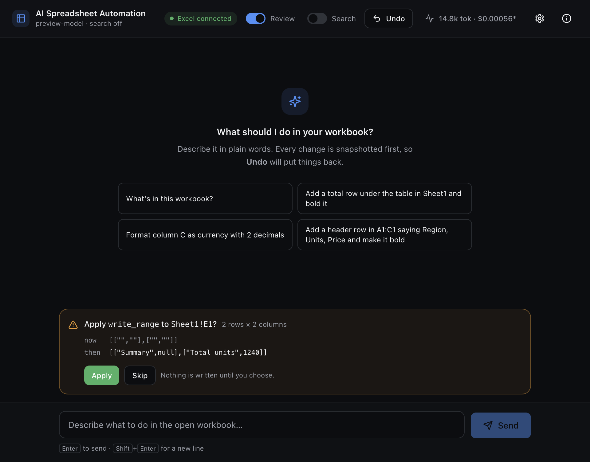

# AI Spreadsheet Automation

**Describe a task in plain English. It happens in the Microsoft Excel you already have open — and
you can take it back afterwards.**

[](https://github.com/swrd1337/ai-excel-automation/actions/workflows/ci.yml)
[](LICENSE)


```
You:  "add a total row under the table in Sheet1 and bold it"
      → reads the range, writes the formula, bolds the row, tells you what it changed
```



A desktop app drives your **installed** Excel through an Office.js add-in. There is no cloud
service, no account, and no copy of your workbook anywhere. You talk to a window; a small add-in
inside Excel does the work.

---

## Why this one

Most "AI for spreadsheets" either wants your file uploaded somewhere, or generates a formula for you
to paste. This one runs the task in the file you already have open, and treats **being able to undo
it** as a requirement rather than a feature.

- **Your real Excel.** Not a web clone or a re-implementation. A workbook with a pivot table, a
  macro, an external link and ten years of history opens normally, because it is Excel.
- **Every change is undoable — and the undo proves it is still valid.** Before any write the target
  is snapshotted; after it, the cells are fingerprinted. Undo re-reads them and **refuses** if
  anything has touched them since, rather than confidently restoring a stale snapshot over newer
  work.
- **Review mode.** See exactly what will change, as a before/after card, and approve or skip each
  one. Nothing is written until you choose.
- **It restores formulas, not numbers.** A restored cell keeps its formula, because the snapshot is
  taken from formulas — assigning computed values back would silently destroy them.
- **Opt-in web search**, off by default, for facts the workbook does not contain.

## Requirements

- **macOS** — Windows should work through the same add-in, but it is untested ([status](#status))
- **Microsoft Excel for Mac**, version 16 or later
- **Node.js 20+**
- A **DeepSeek API key** — DeepSeek is the provider today; Claude is planned

## Quick start

```bash
git clone https://github.com/swrd1337/ai-excel-automation.git
cd ai-excel-automation
npm install

npm run desktop        # builds, then opens the window
```

On first run the app installs itself into Excel: it generates a local HTTPS certificate, stores it,
and writes the add-in manifest into Excel's add-in folder. One step **cannot** be automatic — macOS
requires a password for any change to a certificate's trust settings, so the app asks you to run:

```bash
npm run trust-cert     # macOS will ask for your password, once
```

Then, in Excel: **Insert → Add-ins → My Add-ins → AI Spreadsheet Automation** — and keep that pane
open while you work. Set your API key from the **gear** icon in the window. The window shows what is
still missing and disappears once everything is connected.

After that, `npm run desktop` is the whole thing.

## What it can do today

Twelve operations, each with a typed undo. A tool the taskpane has not advertised is refused rather
than attempted, and the model is only ever offered what is actually available.

| Tool | What it does |
|---|---|
| `get_workbook_overview` · `read_range` · `get_selection` | Read sheets, ranges and the current selection |
| `write_range` · `set_formula` | Write values or formulas, with a shape check against the target |
| `format_range` | Bold, italic, font colour, fill, number format, alignment |
| `sort_range` | Multi-key sort within a range |
| `remove_duplicates` | De-duplicate rows on the columns you name |
| `create_table` | Turn a range into a real Excel table (ListObject) |
| `create_chart` | Charts from a range, in 17 types |
| `create_pivot_table` | Group and total by source header name |
| `web_search` | Opt-in lookup for facts outside the workbook |

## How it works

Three processes, all on your machine:

```
┌────────────────────┐        ┌──────────────────────┐        ┌─────────────────────┐
│  Desktop window    │  HTTP  │   Local Node server  │  poll  │  Excel taskpane     │
│  Electron + React  │ ─────▶ │  model · keys · undo │ ◀───── │  Office.js worker   │
│  chat + approvals  │  NDJSON│  journal on disk     │        │  no dependencies    │
└────────────────────┘        └──────────────────────┘        └─────────────────────┘
                                      │                                  ▲
                                      └──── dispatches every ────────────┘
                                            workbook operation
```

The taskpane long-polls the server for work and posts results back. The model never touches Excel
directly: it asks for a tool, the server checks that the tool was advertised, snapshots the target,
optionally waits for your approval, and only then dispatches it. Replies stream to the window as
newline-delimited JSON events, so tool activity shows up inline as it happens.

The server has **zero runtime dependencies** — Node built-ins only. The taskpane runs inside Excel's
WebView with no bundler and no dependencies. Everything is TypeScript, compiled to a single `dist/`.

## What leaves your machine

Worth being precise about, because "local" is easy to overclaim.

- **The app itself sends nothing anywhere.** It listens on `127.0.0.1` and `::1` only, with no
  telemetry, no analytics, no update check and no account.
- **The model call is the one thing that leaves.** Your task text, the conversation, and whatever the
  tools read from your workbook go to your model provider — DeepSeek by default — to be answered.
  That is unavoidable for any LLM feature, which is why the provider is your choice and your key.
  If a particular sheet should not be sent anywhere, do not point the assistant at it.
- **Your API key travels one way.** It is written to `~/.ai-excel/config.json` (mode `0600`) and is
  never sent back to the window: `GET /api/config` returns only whether a key is set, a masked form,
  and where it came from. A key on the renderer's side of the wire is a key in devtools and in every
  screenshot.
- **Web search is opt-in per request.** A configured search key makes searching *possible*; the
  toggle in the header makes it *happen*, and off is the default.

## The undo model

This is the part that took the longest, so it is worth a paragraph.

Not every change is a range of cells. Restoring cell values cannot un-create a table, a chart or a
pivot table, so the journal is a **union of typed actions**, and each kind reverses itself honestly:

| Kind | Undo | Why not the obvious thing |
|---|---|---|
| `range` | Restore formulas, number formats, font, fill, alignment | Restoring `values` would destroy formulas |
| `created-table` | `convertToRange()` | `delete()` would take the data with it |
| `created-chart` | `delete()` | A chart owns no cells, so nothing is lost |
| `created-pivot` | `delete()` | A pivot's cells are its own output, recomputed from source |

The rule underneath: **an object may be deleted only if it owns the cells it appears to occupy.**
Get it backwards and the failure is silent in both directions — `delete()` a table and undo has
destroyed data; `convertToRange()` a chart and undo reports success having changed nothing.

The journal persists to `~/.ai-excel/journal.json`, which means it can outlive the workbook it
describes. So every entry carries a fingerprint of what it left behind, and undo refuses when the
cells have moved on. Writing an old snapshot over newer work is exactly the data loss the journal
exists to prevent.

## Status

Honest about what this is and is not.

**Working and verified in Excel 16.113 on macOS:** the chat window, streamed replies, the tool loop,
the undo model above, the review gate, live cost accounting, and 22 Diagnostics checks covering the
Office.js behaviour the app depends on — all passing.

**Not done yet:**

- **macOS only.** Windows should work through the same add-in, but the setup step that writes into
  Excel's add-in folder is macOS-specific and has never been run there.
- **No packaged build.** It runs from a source checkout via `npm run desktop`. A `.dmg`/`.msi` is the
  next milestone — the automatic setup that makes it possible landed only recently.
- **DeepSeek only.** The provider sits behind a small interface; Claude is the next one, and last.
- **One workbook at a time.** The session uses a fixed id, so with two workbooks open, whichever
  taskpane is polling answers. A *stale* undo is caught by the fingerprint; two live taskpanes
  racing is not yet.

The full backlog, ordered and with what is deliberately deferred, is **[TODO.md](TODO.md)**.

## Project docs

The engineering log ships with the repository. It is the most useful thing here if you want to know
*why* something is the way it is — including the decisions that were wrong first, and what proved it.

| File | What is in it |
|---|---|
| [AGENTS.md](AGENTS.md) | The contributor contract: 22 invariants, each with the reason and the trap behind it |
| [docs/ARCHITECTURE.md](docs/ARCHITECTURE.md) | Components, protocols and data flow |
| [docs/DECISIONS.md](docs/DECISIONS.md) | 34 dated decisions, with the reasoning and the evidence |
| [TODO.md](TODO.md) | Everything outstanding, with the open questions that block it |
| [app/README.md](app/README.md) | Setup in more detail, plus troubleshooting |

## Development

```bash
npm run build              # clean, compile TypeScript, copy assets, bundle the UI
npm test                   # 67 checks — no Excel, no network, no API key
npm run typecheck:ui       # the React app, no emit
npm run validate:manifest  # Microsoft's schema validator, over the rendered add-in manifest

npm run preview            # scripted model + fake Excel, for working on the UI
npm run desktop -- --smoke --no-sandbox   # hidden window; fails on console errors, screenshots
```

The suite stands a scripted model in for DeepSeek and an in-memory sheet for Excel, but the HTTP
layer, the executor channel, the tool loop, the credential handling and the safety journal are the
real code. It never touches your keychain, your workbook, or a real API key.

## Contributing

Issues and pull requests are welcome — see [CONTRIBUTING.md](CONTRIBUTING.md). The invariants in
[AGENTS.md](AGENTS.md) are the short version of what not to break, and each one links to the
decision that explains it.

## License

[MIT](LICENSE).
